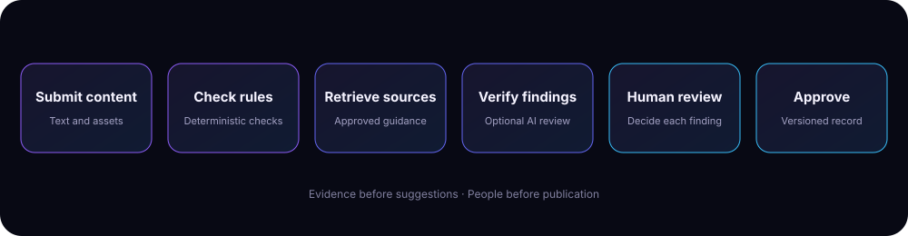

<div align="center">


# BrandGuard

### Brand consistency, grounded in evidence.

**Catch brand mistakes before they go live.**

An explainable brand-governance workspace that checks content against approved guidelines and facts, traces every finding to its source, and keeps people in control of the final approval.

<p>
  <a href="https://github.com/aayush-as69/BrandGuard/actions/workflows/ci.yml"></a>
  
  
  <a href="docs/README.md"></a>
</p>

<a href="#why-brandguard">Why BrandGuard</a> ·
<a href="#capabilities">Capabilities</a> ·
<a href="#quick-start">Quick start</a> ·
<a href="#deploy-it-render">Deploy</a> ·
<a href="#documentation">Documentation</a> ·
<a href="#architecture">Architecture</a>

</div>

---

## Why BrandGuard

Brand reviews often depend on scattered documents, memory, and subjective feedback. BrandGuard gives teams one review path with traceable evidence and clear ownership.

| Challenge | BrandGuard approach |
|---|---|
| Guidelines are spread across files | Import and manage a searchable knowledge base |
| Brand checks are hard to explain | Every finding points to a rule, approved fact, and source quote |
| AI can make unsupported claims | AI findings are verified against source text and rule evidence |
| Suggestions can change meaning | People accept, edit, or dismiss suggestions; nothing is auto-applied |
| Approval is difficult to audit | Version history, comments, decisions, and audit records stay together |
| Some facts are restricted | Role-based access and source-aware redaction protect confidential guidance |

## Capabilities

### Evidence-based content review
- Deterministic checks run first for glossary terms, tone rules, prices, dates, claims, image alt text, and colour contrast.
- Findings include the matched text, source, severity, and confidence.
- Claim checks distinguish supported claims, contradictions, and statements without an approved source.
- Suggested edits are presented as diffs. Authors can accept, edit, or dismiss them.

### A controlled review workflow
- Creator, manager, reviewer, and administrator roles.
- Comments, content versions, review decisions, and an audit trail.
- Approval is enforced by the server: every finding must be decided, and an approver cannot approve their own work.
- Approved content is locked against further edits.

### Knowledge base and access controls
- Import guidelines from PDF, DOCX, TXT, and Markdown.
- Manage approved facts, glossary terms, assets, and access levels.
- Public, internal, and confidential source visibility.
- External agency users cannot browse the knowledge base; restricted source details and suggested fixes are redacted.

### Optional AI tone and messaging review
- The AI judge is optional and can be disabled.
- It receives the content under review and only the relevant retrieved guideline rules.
- Email addresses, links, money amounts, phone numbers, and handles are masked by default.
- AI output must cite a real rule quote and an exact content span. Invalid output is discarded.
- AI findings are labelled, capped at medium confidence, and never applied automatically.

### Operations and accessibility
- Printable approval records with cited sources and audit history.
- Guideline insights for managers, reviewers, and admins.
- A public landing page and a separate sign-in page (`/login`) for real accounts.
- Guided demo tour, keyboard support, responsive layouts, and contrast checks.
- Health endpoint, structured logs, migrations, backup/restore tooling, Docker support, and CI checks.

## Quick start

### Requirements
- Python 3.11–3.13
- pip
- Optional: Chromium for end-to-end browser tests
- Optional: an API key for the AI tone and messaging judge

### 1. Clone and install

```bash
git clone https://github.com/aayush-as69/BrandGuard.git
cd BrandGuard
python -m venv .venv
```

Activate the environment:

```bash
# Windows PowerShell
.venv\Scripts\Activate.ps1

# macOS / Linux
source .venv/bin/activate
```

Install development dependencies:

```bash
python -m pip install --upgrade pip
pip install -r requirements-dev.txt
```

### 2. Configure the environment

For the default local demo, no environment file is required; the app uses demo identities automatically. To configure a production-like setup, copy the example file:

```bash
cp .env.example .env
```

On Windows PowerShell:

```powershell
Copy-Item .env.example .env
```

Edit the file and set a long, unique BRANDGUARD_SECRET. Never commit the real .env file or share production credentials. See the [environment template](.env.example) and [deployment guide](docs/DEPLOYMENT.md).

### 3. Start the application

```bash
python run.py
```

Open **http://127.0.0.1:5000**.

In the development demo, choose a demo identity from the sign-in selector. Start the guided tour from the **Tour** button, or load the synthetic Brewline Coffee knowledge base from the Knowledge base tab.

### 4. Run the tests

```bash
python -m pytest -q
```

The suite contains about 225 tests. Browser tests run when their browser dependencies are available and otherwise skip. See [Testing](docs/TESTING.md) for the full test and manual verification guide.

## Demo walkthrough

The included demo uses **Brewline Coffee**, a fictional brand. All seeded content is synthetic.

1. Sign in as **Ira (admin)** and open **Knowledge base**.
2. Select *Load Brewline demo knowledge base*.
3. Sign in as **Neha (agency creator)**.
4. Open **New**, load the demo email, and select **Review now**.
5. Inspect the source-backed findings. Accept or edit a suggestion, or dismiss it with a reason.
6. Submit the content for approval.
7. Sign in as **Arjun (manager)** or **Meera (reviewer)** to complete the approval flow.

## Deploy it (Render)

`render.yaml` is a **free-tier demo blueprint**: Docker, no persistent disk, so the database resets whenever the service restarts or sleeps. For real content, use a paid instance with a disk (see [Deployment](docs/DEPLOYMENT.md)).

1. In Render choose **New → Blueprint** and select this repository.
2. Fill in the secret values it asks for (below) and apply. The first build takes a few minutes.
3. Open `/healthz` (should say OK), then **Sign in**.

| Variable | Purpose |
|---|---|
| `BRANDGUARD_ADMIN_EMAIL`, `BRANDGUARD_ADMIN_PASSWORD` | First admin account. The password needs 10+ characters. Created only when no admin exists yet |
| `BRANDGUARD_SECRET` | Session signing key (generated by the blueprint) |
| `BRANDGUARD_SEED_DEMO=1` | Load the Brewline demo knowledge base into an empty workspace on start |
| `BRANDGUARD_DEMO_PASSWORD` | With seeding on, also creates `neha@`, `arjun@`, `meera@` and `rahul@brewline.demo` (shared password) and one sample draft. Demo sites only |
| `BRANDGUARD_LLM_API_KEY` | Key for the optional AI check (see the next section) |

**Signing in.** Visitors see a landing page; **Sign in** opens `/login`. Use the admin email and password above, or a demo account when seeding is on. After a wipe on the free tier, the admin account and (if enabled) the demo data are recreated on the next start.

## Optional AI provider

The deterministic review works without an AI key. To enable the optional tone and messaging judge, configure one of the supported providers.

**Anthropic**

```bash
export ANTHROPIC_API_KEY="your-api-key"
```

**OpenAI-compatible provider**

```bash
BRANDGUARD_LLM_BASE_URL=https://your-provider.example/v1
BRANDGUARD_LLM_API_KEY=your-api-key
BRANDGUARD_MODEL=your-model-name
```

**BharatCode** (OpenAI-compatible; the blueprint's default): base URL `https://bharatcode.ai/api/model/v1`, model `qwen-3.8-27b`, key from your BharatCode account. Output limits include reasoning, so these settings matter:

| Variable | Default | Note |
|---|---|---|
| `BRANDGUARD_LLM_REASONING` | `none` (blueprint: `medium`) | `none`, `low`, `medium`, `high`, or `omit` to send nothing |
| `BRANDGUARD_LLM_MAX_TOKENS` | `4000` (blueprint: `8000`) | Up to 32000. Raise it when reasoning is on |
| `BRANDGUARD_AI_TIMEOUT` | `20` (blueprint: `60`) | Seconds a review waits for the AI before finishing with rules only |

An answer cut off by the token limit is discarded, not used and not retried. If both `BRANDGUARD_LLM_BASE_URL` and `ANTHROPIC_API_KEY` are set, the OpenAI-compatible provider is used. Keep API keys in environment variables or your deployment platform's secret manager. Do not put credentials in source files, screenshots, or issue reports.

The AI judge only runs when it is enabled for a review. Authors see an AI-use notice and can opt out for an individual review. See [AI privacy](docs/PRIVACY.md) for exactly what is sent, masked, logged, and retained.

## Screenshots

Place current application screenshots in docs/screenshots/. Recommended captures:

| Screenshot | What it should explain |
|---|---|
| 01-content-review.png | Content workspace, review status, and evidence-backed findings |
| 02-finding-details.png | Source quote, severity, confidence, and suggested diff |
| 03-knowledge-base.png | Guidelines, facts, glossary, and asset management |
| 04-approval-workflow.png | Decisions, comments, and approval controls |
| 05-guideline-insights.png | Repeated issues and frequently disputed rules |

Use synthetic demo content only. Do not capture real customer content, credentials, personal data, or confidential brand material.

## Architecture

<div align="center">
  
</div>

The review pipeline keeps deterministic checks and evidence verification authoritative:

```text
Submitted content
      |
      v
Parse text and attached assets
      |
      v
Deterministic rules ------ Knowledge base retrieval
      |                              |
      +--------------+---------------+
                     v
              Optional AI judge
                     |
                     v
           Verify rule quote and span
                     |
                     v
               Store findings
                     |
                     v
          Human review and decision
                     |
                     v
          Manager / reviewer approval
                     |
                     v
          Versioned approval record
```

### Main design decisions

| Decision | Reason |
|---|---|
| Rules first, AI second | Deterministic checks remain fast and explainable |
| One validated finding model | Findings require source evidence, severity, and confidence |
| Verified AI output | Fabricated rules, quotes, or text spans are discarded |
| Human approval | Suggestions never publish content or replace reviewer decisions |
| Server-side permissions | Access and approval rules are enforced beyond the interface |
| Source-aware redaction | Users cannot infer restricted values through findings or suggested fixes |
| SQLite for the current deployment shape | Simple operation and backup for a single-instance team deployment |

### Repository structure

```text
BrandGuard/
├── brandguard/          # Flask app, review engine, workflow, retrieval, AI, and data layer
├── static/              # HTML, CSS, JavaScript, and printable record styles
├── seed/                # Synthetic Brewline Coffee demo knowledge base
├── docs/                # Deployment, testing, privacy, and security guides
├── scripts/             # Backup, restore, smoke test, and live AI checks
├── tests/               # Unit, integration, security, and browser tests
├── assets/              # BrandGuard logo and architecture diagrams
├── .github/workflows/   # CI, browser tests, and dependency audit
├── run.py               # Local development entry point
├── requirements.txt     # Runtime dependencies
└── requirements-dev.txt # Runtime and test dependencies
```

## Documentation

| Guide | Description |
|---|---|
| [Deployment](docs/DEPLOYMENT.md) | Local and production setup, proxy configuration, health checks, migrations, monitoring, backups, and restore |
| [Testing](docs/TESTING.md) | Automated tests, live-provider tests, deployment smoke test, accessibility checks, and restore drill |
| [Security](docs/SECURITY.md) | Accounts, sessions, roles, source access, request safety, uploads, and known security boundaries |
| [Privacy](docs/PRIVACY.md) | Data storage, AI disclosure, masking, request logs, retention, and deletion |
| [Environment template](.env.example) | Available configuration variables and safe defaults |

## Security and privacy notes

BrandGuard makes its security boundaries visible; this does not mean every deployment is automatically production-ready.

- Production mode requires real accounts and a configured secret.
- Passwords are hashed; sessions are signed and can be revoked through account changes.
- Cross-site state-changing requests are rejected, and the UI is served with a restrictive Content Security Policy.
- The database is not encrypted by the application. Use encrypted storage and protect backups.
- Two-step sign-in and proxy-based SSO are available but optional.
- The current data model serves one organisation per database; tenant isolation is not implemented.
- The AI masking layer covers common identifiers and contact patterns, not every possible secret or unreleased project name.

Read the complete [Security](docs/SECURITY.md), [Privacy](docs/PRIVACY.md), and [Deployment](docs/DEPLOYMENT.md) guides before using real brand or customer data.

## Known limitations

- The current deployment model is a single organisation and SQLite database. Heavy concurrent writes or multiple application instances call for a PostgreSQL-backed deployment.
- AI checks use an in-process background thread rather than an external job queue.
- TOTP and proxy-based SSO are optional rather than mandatory.
- The application does not encrypt the live database at the application layer.
- Sentence and claim extraction is English-oriented and may miss unusual phrasing.
- Rule-based suggestions are deliberately conservative; richer intent-preserving rewrites are future work.
- Image checks evaluate metadata and estimated colour contrast. They do not use a vision model to identify image contents or verify that a logo is correct.
- BrandGuard supports review workflows; it is not legal advice or a substitute for a brand owner's final judgement.

## Development and contribution

Before opening a pull request:

1. Install development dependencies with pip install -r requirements-dev.txt.
2. Run python -m pytest -q.
3. Check JavaScript syntax with node --check for files in static/js/.
4. Keep demo fixtures synthetic and do not add secrets, customer material, or unapproved brand assets.
5. Update the relevant documentation when behavior, configuration, or security boundaries change.

CI runs the Python test suite, JavaScript syntax checks, browser tests, and a dependency audit. See the [workflow](.github/workflows/ci.yml).

## Project context

Built for **CodeTitan Hackathon · Team STARTEND · Round 2: The Build**.

The project was developed by **Aayush Singh**. AI tools assisted with planning and implementation; the code and project decisions were reviewed by the author. BrandGuard's optional AI judge is a separate product feature and its findings are explicitly labelled.

---

<div align="center">


**BrandGuard — clear evidence. Human decisions. Consistent brands.**

[Repository](https://github.com/aayush-as69/BrandGuard) · [Issues](https://github.com/aayush-as69/BrandGuard/issues)

</div>
